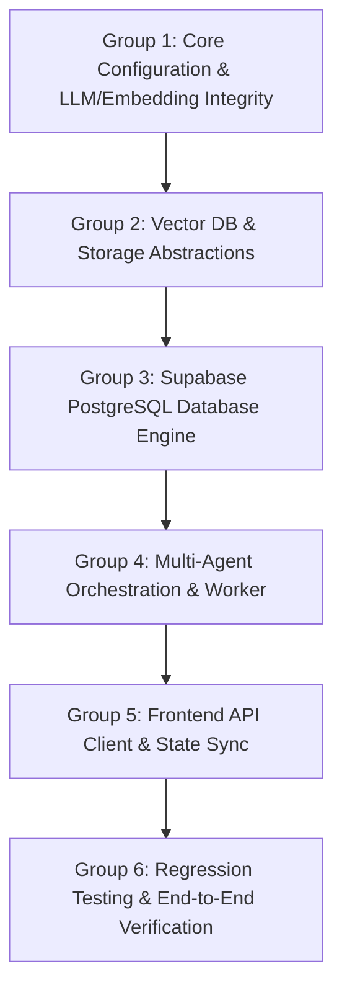

# Comprehensive Repair & Verification Plan
## Multi-Agent Financial Research System

**Document Version:** 1.0.0  
**Status:** Completed & Ready for User Manual Execution  

---

### Dependency-Ordered Execution Architecture

---

### Group 1: Core Configuration & LLM / Embedding Integrity
* **Objectives:** Eliminate invalid model names, ensure strict vector dimensionality, and remove silent mock fallbacks on quota exhaustion.
* **Source Files Modified:**
  1. `app/config.py`: Set default `llm_model = "gpt-4o"`.
  2. `app/infrastructure/llm/provider.py`: Remove silent 429 mock fallback, set default model to `"gpt-4o"`, and raise informative `RuntimeError` on insufficient quota.
  3. `app/infrastructure/document_processing/embedder.py`: Remove 1,152 zero-padding on 429 quota exhaustion; enforce strict vector dimensionality or throw explicit `RuntimeError`.
* **Dependencies:** None (foundation for all downstream services).

---

### Group 2: Vector Database & Storage Abstractions
* **Objectives:** Implement scroll-based chunk retrieval for Qdrant Cloud without dummy vectors; maintain Supabase private storage bucket integrity.
* **Source Files Modified:**
  1. `app/infrastructure/vector_store/qdrant.py`:
     - Implemented `get_chunks_by_document(document_id)` using `/collections/{name}/points/scroll`.
     - Increased cold-start connection timeouts to 10.0s for cloud resilience.
  2. `app/agents/extraction_agent/service.py`: Replaced hardcoded `[0.0] * 384` with `self.vector_store.get_chunks_by_document(document_id)`.
  3. `app/agents/red_flag_agent/service.py`: Replaced hardcoded `[0.0] * 384` with `self.vector_store.get_chunks_by_document(document_id)`.
  4. `app/infrastructure/storage/supabase_storage.py`: Preserved dual REST + Python SDK engine with secure authenticated downloads.
* **Dependencies:** Requires Group 1 (correct embedding dimensions).

---

### Group 3: Supabase PostgreSQL Database Engine
* **Objectives:** Connect directly to Supabase PostgreSQL using SQLAlchemy 2.0 and psycopg3; preserve local SQLite as a zero-credential development fallback.
* **Source Files Modified:**
  1. `app/infrastructure/database/repository.py`:
     - Added `is_healthy()`, `recover_stale_jobs()`, and `get_queue_stats()` to `DatabaseRepositoryInterface`.
     - Implemented `SQLiteRepository` concrete methods.
     - Fully implemented `SupabasePostgresRepository` with connection pooling, parameterized queries (`:param`), JSONB casting, and `FOR UPDATE SKIP LOCKED` for job claiming.
  2. `app/api/routes/health.py`: Updated health route to use `repo.is_healthy()` and `repo.get_queue_stats()`.
* **Dependencies:** Requires Alembic migration `001_initial_ai_service_tables`.

---

### Group 4: Multi-Agent Workflow Orchestration & Asynchronous Worker
* **Objectives:** Provide durable job tracking, eliminate duplicate job generation, prevent double LLM extraction, and enforce rigorous citation validation.
* **Source Files Modified:**
  1. `app/orchestration/workflow.py`:
     - Added `job_id: Optional[str] = None` to `MultiAgentWorkflowOrchestrator.run_pipeline`.
     - Reuses existing claimed job if passed; updates stage dynamically.
     - Auto-provisions `default-workspace` if missing when targeted.
     - Enhanced `evidence_validation_node` with provenance and page bounds checking.
     - Threaded extracted model through `state.extracted_financials["_model"]` to eliminate duplicate extraction in Red Flag node.
  2. `worker.py`: Updated to use `repo.recover_stale_jobs()` method call.
* **Dependencies:** Requires Group 2 & Group 3.

---

### Group 5: Frontend API Client, State Sync & Navigation
* **Objectives:** Remove fabricated mock defaults, eliminate cross-document stale data leakage, and ensure 1:1 navigation matching between Sidebar and views.
* **Source Files Modified:**
  1. `Finanical-Research/src/services/api.js`: Overhauled API client with timeouts via `AbortController`, live status detection, proxy-aligned file retrieval URLs, and removal of mock fallbacks.
  2. `Finanical-Research/src/App.jsx`: Updated `navigateTo` to handle all Sidebar IDs (`extraction`, `evidence`, `redflags`, etc.) and synchronized live backend records over local cache.
  3. `Finanical-Research/src/components/Sidebar.jsx`: Synchronized active item highlighting with `analysisTab` and `activePage`.
  4. `Finanical-Research/src/pages/ResearchWorkspace.jsx`: Immediate state reset on document change; cancellation tokens; enabled `evidence` tab rendering.
  5. `Finanical-Research/src/pages/DocumentDetails.jsx`: Reset live chunks on document change; replaced fake metadata with actual document values.
  6. `Finanical-Research/src/pages/RetrievalPreview.jsx`: Replaced simulated search with live FastAPI `/search`.
* **Dependencies:** Requires Group 1, Group 2, Group 3, and Group 4.

---

### Group 6: Verification & Regression Testing
* **Objectives:** Provide automated unit and regression tests in `tests/` and exact PowerShell manual verification commands.
* **Source Files Created/Updated:**
  1. `tests/test_audit_repairs.py`: Regression tests for dimension enforcement, Qdrant scroll, job reuse, evidence bounds, and repository recovery.
  2. `tests/test_llm_provider.py`: Quota exhaustion error test.
  3. `docs/API_CONTRACT_AUDIT.md`: Complete API parity matrix.
  4. `docs/IMPLEMENTATION_STATUS.md`: Complete status and verification playbook.
* **Dependencies:** Requires Groups 1–5.

