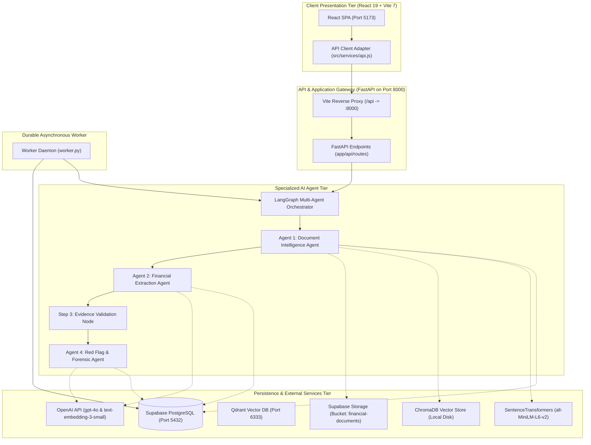
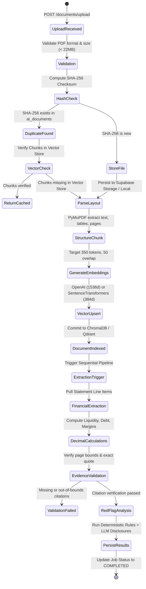
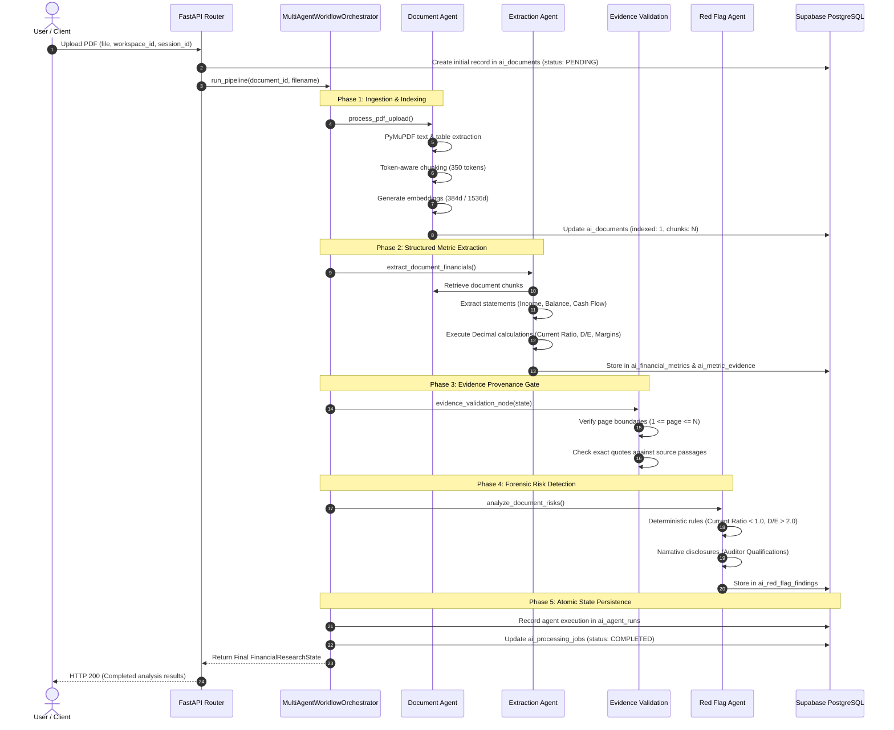
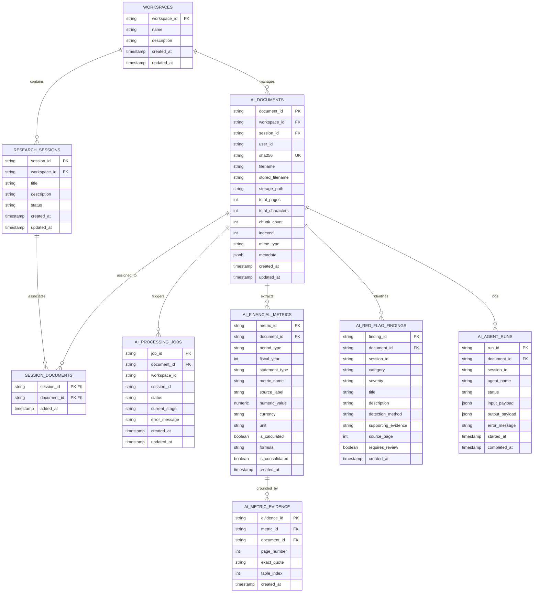

# SYSTEM ARCHITECTURE & DATA FLOW SPECIFICATION

**Document Version:** 1.0.0  
**Generated Date:** November 12, 2026  
**Module:** Multi-Agent Financial Research System  
**Auditor:** Senior Software Architect

---

## 1. High-Level System Architecture

The application is structured into decoupled, enterprise-grade tiers: a React 19 single-page client, a Python FastAPI microservice engine, a dual-layer persistent storage tier (PostgreSQL + Supabase Object Storage), and an AI vector memory store.

---

## 2. Document Processing & Ingestion Lifecycle

The complete lifecycle of a financial filing moves through eleven deterministic steps from physical upload to indexed analysis:

---

## 3. Sequential Multi-Agent Workflow Sequence

The workflow coordinates specialized agents sequentially to prevent hallucination, guarantee citation boundaries, and enforce deterministic mathematical accuracy:

---

## 4. Database Entity-Relationship (ER) Architecture

The relational schema in Supabase PostgreSQL enforces strict referential integrity across research workspaces, AI documents, extraction results, and forensic findings:

---

## 5. Agent Architecture & Responsibility Matrix

| Agent / Node | Primary Responsibility | Input Contract | Output Contract | Verification Rule |
| :--- | :--- | :--- | :--- | :--- |
| **Document Agent** | PDF parsing, table extraction, chunking, embedding, vector indexing | Raw PDF bytes / storage path | `DocumentUploadResponse`, Vector chunks | Zero unindexed chunks; SHA-256 idempotency |
| **Extraction Agent** | Extraction of line items, statements, Python `Decimal` ratio calculations | Indexed document chunks | `ExtractedFinancials`, `ai_financial_metrics` | Zero floating-point drift; exact Decimal math |
| **Evidence Validation** | Source quote & page number verification | Extracted metrics & citations | Validated state flag | Rejects out-of-bounds pages ($> N$) & hallucinated quotes |
| **Red Flag Agent** | Deterministic rule execution + narrative disclosure risk scanning | Extracted financials & text | `List[RedFlagFinding]` | Triggers strictly on breach thresholds; 0 false alarms on sound metrics |
| **Persistence Node** | Atomic persistence of run logs, metrics, red flags, job completion | State object | Updated database records | Atomic commits with row-level transaction safety |

